<div align="center">

# YouTube Editorial Transcription Workflow

**An End-to-End YouTube Video Transcription & Editorial Publishing Workflow for AI Industry Editors**  
Dialogue transcripts, illustrated deep-dives, three-role Agent Council QA, collaborative Notion publishing, and daily Podcast Radar.

[简体中文](README.md) | **English**

[](LICENSE)
[](https://www.python.org/)
[](tests/run_all.py)

</div>

---

## Workflow Architecture



---

## Key Capabilities

| Module | Description | Core Files |
| :--- | :--- | :--- |
| **Daily Podcast Radar** | Zero-API-key monitor across 20 AI podcast RSS feeds. Scores episodes by relative velocity (`views / channel mature median × age maturity curve`) to surface breakout interviews regardless of channel size. | `radar.py`, `radar_channels.json` |
| **Dual-Source Transcript Gate** | Automatically orchestrates `youtube-transcript.io` (paid API) and `youtube-transcript-api` (free direct fetch) with `>= 90%` duration coverage verification and Latin-script ratio guardrails to reject mislabeled auto-translated tracks. Supports `--prefer-free` for zero-quota topic screening. | `fetch_transcript.py`, `http_utils.py` |
| **Multi-Mode Drafting Router** | Routes source videos into **Mode A (Illustrated Deep-Dive)**, **Mode B (Speaker-Attributed Dialogue Transcript / Keynote Record)**, or **Mode C (Multi-Source Industry Commentary)**. Automatically splits `>45 min` videos by chapters for 3-way parallel drafting with resumable checkpoints. | `split_and_stitch.py`, `skills/*.md` |
| **Fact-Check & Static Linter** | Enforces line-by-line verification against raw `transcript.json` for figures, proper nouns, causality, and speaker hedging. Zero-token linters catch timestamp reversals, silent `>=2 min` omissions, blank-line layout rules, number formatting, banned clichés, and glossary drift. | `check_transcript_edit.py`, `check_mode_b.py`, `glossary.md` |
| **Three-Role Agent Council QA** | Separates drafting from review using independent **Progressive + Conservative reviewers → Judge** to eliminate factual errors, over-claimed headlines, and translationese before publication. | `skills/council/*.md`, `skills/reader_facing_review.md` |
| **Editorial Diagram Engine** | Routes all technical diagrams and charts through the `diagram-design` skill (52 editorial visual types, 4px grid, 6 mandatory orthogonal connector rules, and automated geometry/contrast verification) with clean SVG/PNG export. | `skills/diagram_style.md` |
| **Idempotent Notion Sync & Ratchet Loop** | Converts Markdown headings, tables, code blocks, callouts, lists, and local images (via Notion File Upload API with path-traversal and extension guards) into Notion pages. Deduplicates by URL + artifact suffix, verifies via read-back, supports Notion comment-driven revisions, and distills recurring feedback into permanent rules. | `notion_upload.py`, `notion_read.py` |

---

## Quick Start

### 1. Clone & Install Dependencies

```bash
git clone https://github.com/shirleyisdoingrightthings/youtube-transcript-scraper-and-summary.git
cd youtube-transcript-scraper-and-summary
pip install -r requirements.txt
```

### 2. Configure Environment Variables

```bash
cp .env.example .env
```

Fill in `.env` (gitignored and never committed):

| Variable | Description | Required |
| :--- | :--- | :--- |
| `NOTION_API_KEY` | Notion Internal Integration Secret | Required for Notion sync |
| `NOTION_DATABASE_ID` | 32-character target Notion Database ID | Required for Notion sync |
| `YOUTUBE_TRANSCRIPT_API_KEY` | `youtube-transcript.io` token (without `Basic ` prefix) | Optional (`--prefer-free` works without a key) |
| `EXA_API_KEY` | Exa Search & Fetch API key for primary-source fact verification | Optional |

### 3. (Optional) Local Brand & Byline Overrides

To customize editorial bylines, brand headers, or visual style locally without exposing personal branding in git, copy the example template (gitignored):

```bash
cp skills/local_overrides.example.md skills/local_overrides.md
```

### 4. Run Regression Tests

Zero external test dependencies (standard library only):

```bash
python3 -B tests/run_all.py
```

---

## CLI Cheat Sheet

```bash
# 1. Scan top breakout AI podcast episodes over the past 7 days
python3 -B radar.py run --days 7

# 2. Fetch transcript (--prefer-free saves paid quota during screening)
python3 -B fetch_transcript.py "https://www.youtube.com/watch?v=VIDEO_ID" --prefer-free --output transcript_temp.json

# 3. Split and stitch long videos (>45 min) with resumable checkpoints
python3 -B split_and_stitch.py split transcript_temp.json --parts 3
python3 -B split_and_stitch.py stitch --work-dir output/_work_VIDEO_ID --front-matter front.md --title "Article Title"

# 4. Run timeline gap/reversal check and Mode B static linter
python3 -B check_transcript_edit.py "output/<Title>/<Title> - 逐字稿.md"
python3 -B check_mode_b.py "output/<Title>/<Title> - 逐字稿.md" --pure-text

# 5. Publish idempotently to Notion and verify via read-back
python3 -B notion_upload.py "output/<Title>/<Title> - 图文精读.md" "https://www.youtube.com/watch?v=VIDEO_ID" --category AI --status "To Do"
python3 -B notion_read.py "<Notion Page URL or ID>"
```

---

## Repository Structure

```text
.
├── README.md / README.en.md    # Bilingual project homepages (ZH / EN)
├── LICENSE                     # MIT License
├── SKILL.md                    # Agent skill entry point (Notion comment revision & Ratchet loop)
├── CLAUDE.md / AGENTS.md       # Core workflow orchestration & quality gates (symlinked)
├── glossary.md                 # Bilingual AI terminology & translation glossary
├── radar.py                    # Daily Podcast Radar (RSS polling + relative velocity scoring)
├── radar_channels.json         # Tracked podcast channels & guest watchlist
├── fetch_transcript.py         # Dual-source transcript fetcher + coverage/language gates
├── http_utils.py               # Shared exponential-backoff HTTP client
├── split_and_stitch.py         # Chapter-aware splitter, checkpoint manager & stitcher
├── check_transcript_edit.py    # Timestamp monotonicity, omission scanner & rhythm analyzer
├── check_mode_b.py             # Mode B static editorial linter
├── notion_upload.py            # Markdown -> Notion Blocks uploader + File Upload API
├── notion_read.py              # Notion page read-back for verification & Council review
├── docs/                       # Architecture diagrams generated with diagram-design (ZH & EN SVGs)
├── skills/                     # Output modes, format specs, diagram spec & Agent Council prompts
├── logs/system_changelog.md    # Engineering changelog
└── tests/                      # 10 stdlib-only regression test suites
```

---

## License

Released under the [MIT License](LICENSE).
