<div align="center">

# YouTube 视频深度转写工作流

**面向 AI 行业编辑打造的 YouTube 视频深度转写工作流**  
含逐字稿转录、图文精读稿转录、三角色审稿与 Notion 协同发布、日常选题播客雷达

**简体中文** | [English](README.en.md)

[](LICENSE)
[](https://www.python.org/)
[](tests/run_all.py)

</div>

---

## 工作流架构



---

## 核心能力

| 模块 | 说明 | 核心文件 |
| :--- | :--- | :--- |
| **日常选题播客雷达** | 零 API Key 监控 20 个 AI 行业播客 RSS 频道，基于「本片播放量 ÷ 频道成熟视频中位数 × 天龄成熟度曲线」计算跨频道可比的相对热度，快速筛出值得跟进的爆款新片 | `radar.py`、`radar_channels.json` |
| **双源字幕抓取与质量闸门** | 支持 `youtube-transcript.io`（付费源）与 `youtube-transcript-api`（免费直连）自动切换；内置视频时长覆盖率校验（`< 90%` 自动换源，双源残缺直接失败退出）与拉丁字母占比抽检（拦截非英文自动翻译轨错标）；支持 `--prefer-free` 选题预判零配额消耗 | `fetch_transcript.py`、`http_utils.py` |
| **多形态内容生产路由** | 支持 **模式 A（图文精读稿）**、**模式 B（对话体逐字稿 / 演讲实录）** 与 **模式 C（多信源行业观察稿）**；超过 45 分钟的长视频自动按章节切分、三段并行编译并支持断点续传 | `split_and_stitch.py`、`skills/*.md` |
| **对照核校 + 静态机检** | 强制对照原始字幕逐项核查数字、专名、因果与限定语；配合零 Token 静态机检器检查时间戳单调性、≥2 分钟静默删段、空行状态机、千分位、AI 禁用词与术语统一 | `check_transcript_edit.py`、`check_mode_b.py`、`glossary.md` |
| **三角色 Agent Council 终审** | 起草与审稿严格隔离：互不知情的「激进审稿人 + 保守审稿人 → Judge 裁决」前置清除事实硬伤、立场拔高与翻译腔 | `skills/council/*.md`、`skills/reader_facing_review.md` |
| **专业配图与图解引擎** | 全量配图与机制图解统一对接 `diagram-design` 技能（52 种编辑风视觉类型、4px 栅格、6 条正交连接器硬规则与自动化几何自检），支持一键导出 SVG / PNG | `skills/diagram_style.md` |
| **Notion 幂等同步与棘轮进化** | 自动转换标题、表格、代码块、Callout 与本地图片（Notion File Upload API 托管 + 路径越界拦截），按 URL 与产物类型自动查重归档旧版；上传后强制读回校验，并支持通过 Notion 评论协同改稿与 Ratchet 规则自沉淀 | `notion_upload.py`、`notion_read.py` |

---

## 快速开始

### 1. 克隆并安装依赖

```bash
git clone https://github.com/shirleyisdoingrightthings/youtube-transcript-scraper-and-summary.git
cd youtube-transcript-scraper-and-summary
pip install -r requirements.txt
```

### 2. 配置环境变量

```bash
cp .env.example .env
```

编辑 `.env`（已在 `.gitignore` 中忽略，不会被提交）：

| 变量名 | 说明 | 是否必填 |
| :--- | :--- | :--- |
| `NOTION_API_KEY` | Notion Internal Integration Secret | 同步 Notion 时必填 |
| `NOTION_DATABASE_ID` | 目标 Notion 数据库的 32 位 ID | 同步 Notion 时必填 |
| `YOUTUBE_TRANSCRIPT_API_KEY` | `youtube-transcript.io` Token（不含 `Basic ` 前缀） | 可选（加 `--prefer-free` 可纯免费抓取） |
| `EXA_API_KEY` | Exa 搜索与原文抓取 API Key，用于外文专名与一手信源核实 | 可选 |

### 3. （可选）自定义本地编辑署名与品牌风格

如需在输出稿中固定你的频道署名、品牌头图占位或编者按前缀，复制示例文件即可（该文件已加入 `.gitignore`，不会泄露到公开仓库）：

```bash
cp skills/local_overrides.example.md skills/local_overrides.md
```

### 4. 运行回归测试

测试套件纯 Python 标准库实现，无需安装 `pytest`：

```bash
python3 -B tests/run_all.py
```

---

## 常用命令速查

```bash
# 1. 跑播客雷达：扫描近 7 天异常走热的 AI 播客
python3 -B radar.py run --days 7

# 2. 抓取字幕（选题预判加 --prefer-free 优先免费源）
python3 -B fetch_transcript.py "https://www.youtube.com/watch?v=VIDEO_ID" --prefer-free --output transcript_temp.json

# 3. 长视频（>45 分钟）分段切分、断点续传与拼接归档
python3 -B split_and_stitch.py split transcript_temp.json --parts 3
python3 -B split_and_stitch.py stitch --work-dir output/_work_VIDEO_ID --front-matter front.md --title "中文标题"

# 4. 精编时间轴扫描与模式 B 全量静态体检
python3 -B check_transcript_edit.py "output/<标题>/<标题> - 逐字稿.md"
python3 -B check_mode_b.py "output/<标题>/<标题> - 逐字稿.md" --pure-text

# 5. 上传至 Notion 并读回校验
python3 -B notion_upload.py "output/<标题>/<标题> - 图文精读.md" "https://www.youtube.com/watch?v=VIDEO_ID" --category AI --status "To Do"
python3 -B notion_read.py "<Notion 页面 URL 或 ID>"
```

---

## 仓库目录结构

```text
.
├── README.md / README.en.md    # 中 / 英双语项目主页
├── LICENSE                     # MIT 开源协议
├── SKILL.md                    # Agent 技能入口（含 Notion 评论协同改稿与棘轮自进化）
├── CLAUDE.md / AGENTS.md       # 主工作流编排与质量闸门规范（AGENTS.md 软链至 CLAUDE.md）
├── glossary.md                 # AI 行业中英文术语与译法统一表
├── radar.py                    # 日常选题播客雷达（RSS 采样 + 相对热度打分）
├── radar_channels.json         # 监控频道白名单与关注嘉宾名单
├── fetch_transcript.py         # 双源字幕抓取 + 完整度/语种双重闸门
├── http_utils.py               # 统一 HTTP 指数退避重试
├── split_and_stitch.py         # 长视频章节切分、断点续传与拼接归档
├── check_transcript_edit.py    # 时间戳逆序检测、删段缺口扫描与句长节奏统计
├── check_mode_b.py             # 模式 B 全量静态体检器
├── notion_upload.py            # Markdown → Notion Blocks 幂等上传与本地图直传
├── notion_read.py              # Notion 页面读回（终校 / 核对 / Council 输入）
├── docs/                       # 工作流架构图（基于 diagram-design 生成，含中/英双版 SVG）
├── skills/                     # 输出模式、排版规范、图解规范、专名核查与三角色 Council 模板
├── logs/system_changelog.md    # 系统演进变更记录
└── tests/                      # 10 组零外部依赖回归测试
```

---

## 开源协议

本项目基于 [MIT License](LICENSE) 开源。
